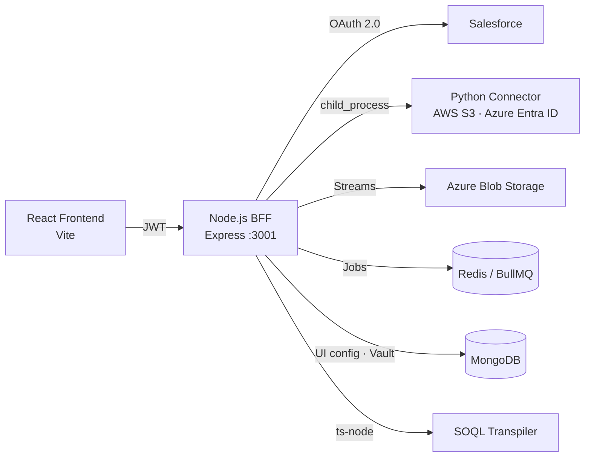

# 🏛️ System Design Patterns Lab

A hands-on lab where each week implements one production-grade system design pattern, all integrated into a single full-stack platform (React + Node.js BFF + Python/TypeScript services) that connects **AWS**, **Azure** and **Salesforce**.

Every major decision is documented as an Architecture Decision Record in [`ADR_PHASE-1.md`](./ADR_PHASE-1.md).

## 🧩 Patterns implemented

| Week | Module | Pattern | Key techniques |
| :--- | :--- | :--- | :--- |
| 1 | [The Connector](./services/week-1-the-connector) | Backend-for-Frontend, multi-cloud identity | OAuth 2.0 (Salesforce), JWT **RS256**, Azure Entra ID, AWS S3 |
| 2 | [Batch Sync](./services/week-2-batch-sync) | Producer–Consumer ETL | Node.js Streams, backpressure, **BullMQ + Redis** queues |
| 3 | [Config Engine](./services/week-3-config-engine) | Server-Driven UI | Recursive React renderer, rules stored as metadata in MongoDB |
| 4 | [SOQL Transpiler](./services/week-4-soql-transpiler) | Compiler pipeline | Lexer → recursive-descent parser → AST → code generation (TypeScript) |
| 5 | [Secure Vault](./services/week-5-secure-vault) | Envelope encryption | **AES-256-GCM**, per-secret data keys wrapped by a master key |

## 🏗️ Architecture



The frontend never handles cloud credentials: it only holds a short-lived JWT issued by the BFF.

## 📂 Repository structure

```
backend/     Node.js BFF: auth, routes, queues, controllers
frontend/    React dashboard (one panel per week)
services/    Independent services, one folder per week
tests/       Connectivity and API health checks
ADR_PHASE-1.md
```

## 🚀 Running locally

**Prerequisites:** Node.js 20+, Python 3.10+, Docker (for Redis and MongoDB), and accounts on the cloud providers you want to test.

```bash
# 1. Infrastructure
docker run -d --name redis -p 6379:6379 redis:7
docker run -d --name mongo -p 27017:27017 mongo:7

# 2. Environment variables
cp .env.example .env        # fill in your own values

# 3. RSA key pair for JWT signing (RS256)
openssl genrsa -out backend/private.key 2048
openssl rsa -in backend/private.key -pubout -out backend/public.key

# 4. Python connector (Week 1)
python3 -m venv venv && venv/bin/pip install -r services/week-1-the-connector/requirements.txt

# 5. Backend and frontend
cd backend && npm install && npm run dev      # http://localhost:3001
cd frontend && npm install && npm run dev     # http://localhost:5173
```

## 🔐 Security notes

- Secrets live only in `.env` and `*.key` files, which are git-ignored. See [`.env.example`](./.env.example) for the full list.
- Third-party tokens stored by the platform are encrypted with envelope encryption (Week 5).

## 🗺️ Roadmap

- [x] Week 1 – Secure multi-cloud connector
- [x] Week 2 – High-volume batch sync
- [x] Week 3 – Server-Driven UI
- [x] Week 4 – SQL → SOQL transpiler
- [x] Week 5 – Secure vault
- [ ] Containerize the full stack with Docker Compose
- [ ] Automated tests in CI (GitHub Actions)
