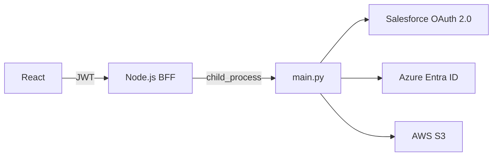

# 🔌 Week 1: The Connector (Multi-Cloud Identity)

> **Core Concept:** One secure entry point that authenticates against three different clouds, so the frontend never touches a cloud credential.

## 📋 Overview

A Python service, triggered by the Node.js BFF (`GET /run-week1`), that proves the platform can talk to all three providers:

1. **Salesforce:** OAuth 2.0 handshake over REST, then a `simple-salesforce` client (`connection_final.py`).
2. **Azure Entra ID:** Client-credentials flow with MSAL to validate the app identity.
3. **AWS S3:** Creates a uniquely named bucket, uploads a file and reads it back (`s3_manager.py`, `s3_reader.py`).

## 🏗️ Architecture



Design decisions are recorded in [ADR 001](../../ADR_PHASE-1.md).

## 🚀 How to Run

```bash
python3 -m venv venv && venv/bin/pip install -r requirements.txt
# credentials come from the root .env (see ../../.env.example)
venv/bin/python s3_manager.py   # creates the bucket and uploads a sample file
venv/bin/python main.py         # runs the full three-cloud handshake
```

## 🛠️ Tech Stack
Python 3, boto3, MSAL, simple-salesforce, python-dotenv.
